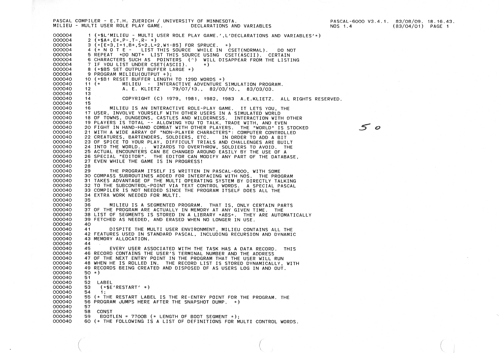

# Scepter of Goth -- Pascal Source Code

This folder contains the mainframe Pascal source code for the Scepter of Goth from the MECC Timeshare System (MTS).

The source code was printed on July 9, 1983, shortly before MTS shut down by the Minnesota Department of Education.

## Need OCR Scan

I am looking for a volunteer to optically scan the CDC Pascal 6000 printout.  The results will be placed in this directory.

To show you an example of the printout, I scanned an image of the first page as `scepter-pascal-page-1.png`.  The total printout length is roughly 10000 lines (200 pages), double-sided, landscaped.

## Tech Specs

- CPU: Control Data Corporation Cyber 73
- Memory: Magnetic core
- Word size: 60 bit
- Character set: 6-bit
- Language: Pascal 6000.
- Memory limit: 40000 octal (16K decimal) words per process (roughly 60 kilobytes).

## About the MECC Timeshare System

The Minnesota Educational Computing Consortium (MECC) was founded by the Minnesota Department of Education in the 1970s for online education.  MECC is remembered best today for the game **Oregon Trail**.

Students could dial in to MTS on ASR33 teletypes with acoustical modems at 110 baud (10 cps). In the early 1980s this was upgraded to DECWriters and VT52s at 300/1200 baud.  

The MTS mainframe could support concurrent access by roughly 400 students, located in high schools across Minnesota.

## About the Multi Subsystem

The Multi subsystem was created by the IT staff at MECC to conserve memory use in order to run the Oregon Trail game, which was the #1 app at the time. Under the Multi subsystem, an app could read keyboard input from a single I/O port (shared stdin). Each input was prefixed with a numerical identifier for the terminal number that it came from. The app sent its output to a single shared stdout using the same prefix.  Although the design made intercommunication theoretically possible, the Oregon Trail game never used it. The game simply echoed the output back to the same prefix. 

Students quickly figured out that it was possible to communicate with each other by connecting the prefixes. Using Multi, they created the first 'talk' programs. The most popular talk program was called **MultiTalk**. This was followed by a space combat game, **Combat** (logajan).

## Memory Constraints

When creating Scepter, the greatest challenge was limiting the app's memory use to under 40K octal words.  Scepter worked around the limit by loading sections of itself on demand using a custom loader written in CDC assembly code.

---

## Scepter Pascal Source Code (page 1)

(Note: Scepter was renamed "Milieu" for a short time in 1983, just before the MTS shutdown.)

